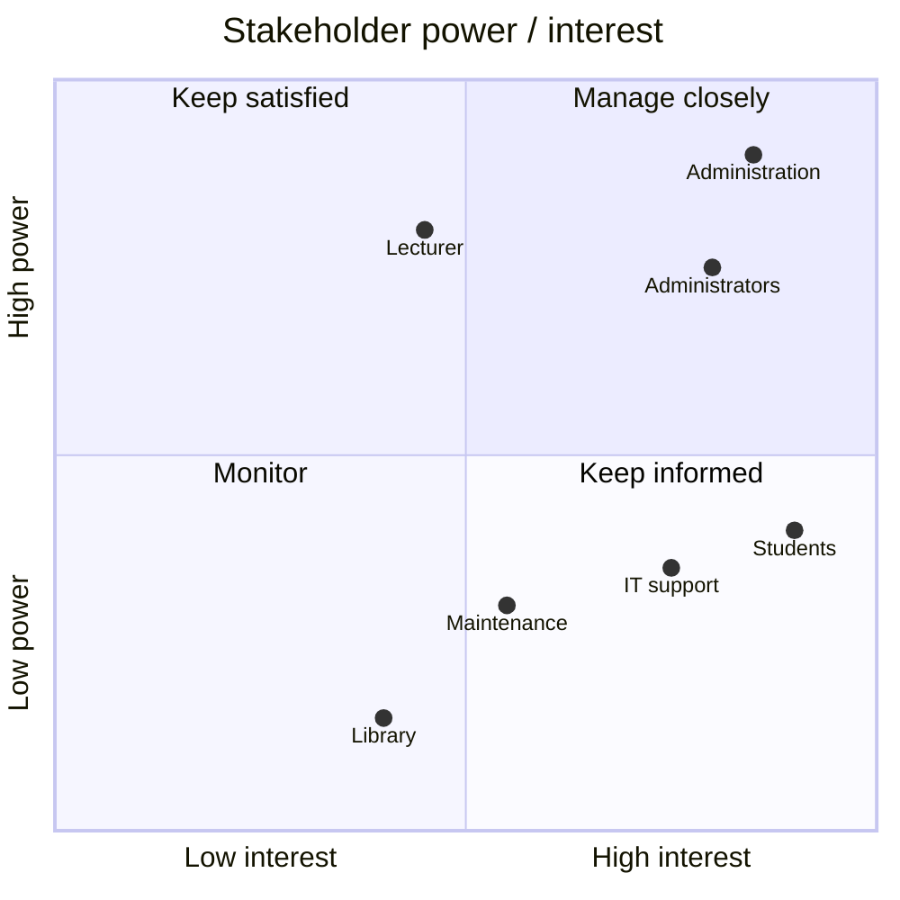

# Requirements and Stakeholder Analysis — CampusHelp

| | |
|---|---|
| **Document ID** | BA-01 (Issue T02) |
| **Version** | 1.0 |
| **Date** | 26 November 2026 |
| **Role** | Business Analyst & Designer (Student B) |

## 1. Stakeholder analysis

| Stakeholder | Interest / need | Influence | Interest level | Engagement strategy |
|---|---|---|---|---|
| Students | Submit a request quickly and know its status without calling | Medium | High | Keep informed — usability review of the request screen |
| University Administration (sponsor) | Visibility of all requests, fewer lost requests, measurable service | High | High | Manage closely — approves charter, scope and changes |
| Administrators / dispatchers | Assign each request to the right staff member, see the backlog | High | High | Manage closely — review of the dashboard |
| IT support staff | Receive clear, categorized IT requests with priority | Medium | High | Keep informed |
| Maintenance staff | Receive classroom / facility requests with location | Medium | Medium | Keep informed |
| Library staff | Receive library assistance requests | Low | Medium | Monitor |
| Lecturer (course assessor) | Evidence of the full PM lifecycle in GitHub | High | Medium | Keep satisfied — milestone and checkpoint reports |

### Power / interest grid

## 2. Functional requirements

| ID | Requirement | Priority | Feature (charter §3) |
|---|---|---|---|
| FR-01 | A student can submit a request with Student ID, full name, e-mail, category, priority, location (optional) and description. | Must | 1 |
| FR-02 | Student ID, category, priority and description are mandatory; the form shows a clear message for every missing or invalid field and does not submit. | Must | 1 |
| FR-03 | Categories: IT Support, Classroom Maintenance, Library Assistance, Administrative Services. | Must | 2 |
| FR-04 | Priority levels: Low, Medium, High. | Must | 2 |
| FR-05 | After a successful submission the system shows a confirmation with a unique request ID (`CH-YYYY-NNNN`). | Must | 3 |
| FR-06 | A student can enter a request ID and see the request's current status and history. | Must | 3, 5 |
| FR-07 | An administrator can assign a request to a staff member. | Must | 4 |
| FR-08 | An administrator can change the status: Submitted → Assigned → In Progress → Resolved → Closed. | Must | 5 |
| FR-09 | The dashboard shows counts of open (Submitted), ongoing (Assigned + In Progress) and completed (Resolved + Closed) requests. | Must | 6 |
| FR-10 | The dashboard lists requests and can filter them by status, category and priority. | Should | 6 |
| FR-11 | Every status change is stored with date and time in the request history. | Should | 5 |
| FR-12 | The student receives an e-mail acknowledgment on submission. | **Deferred — CR-01** (out of scope; see `change-request.md`) | — |

## 3. Non-functional requirements

| ID | Requirement | Measure |
|---|---|---|
| NFR-01 | Usability | A first-time student completes a request in under 2 minutes. |
| NFR-02 | Responsiveness | Screens are usable at 360 px (phone) and 1280 px (desktop) width. |
| NFR-03 | Accessibility | Every form field has a visible label; error messages are text, not colour only. |
| NFR-04 | Data | Request IDs are unique; no request is lost after page reload (prototype: browser storage). |
| NFR-05 | Simplicity | Prototype runs by opening an HTML file — no installation or server. |

## 4. Traceability: features → requirements → test cases

| Feature | Requirements | Test cases (`test-cases.md`) |
|---|---|---|
| 1 Request submission | FR-01, FR-02 | TC-01, TC-04 |
| 2 Categories & priorities | FR-03, FR-04 | TC-02, TC-03 |
| 3 Tracking by ID | FR-05, FR-06 | TC-04, TC-05 |
| 4 Admin assignment | FR-07 | TC-06, TC-07 |
| 5 Status updates | FR-08, FR-11 | TC-05, TC-07 |
| 6 Dashboard | FR-09, FR-10 | TC-06, TC-08 |

## 5. User stories

- *As a student*, I want to submit a request online so that I do not have to send e-mails or fill in paper forms.
- *As a student*, I want a request ID so that I can check the status myself.
- *As an administrator*, I want to see all new requests in one place so that I can assign them quickly.
- *As an administrator*, I want to change a request's status so that the student always sees accurate progress.
- *As the university administration*, I want counts of open, ongoing and completed requests so that I can measure service performance.
