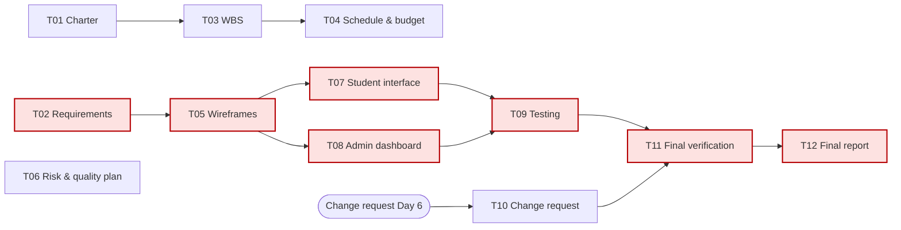
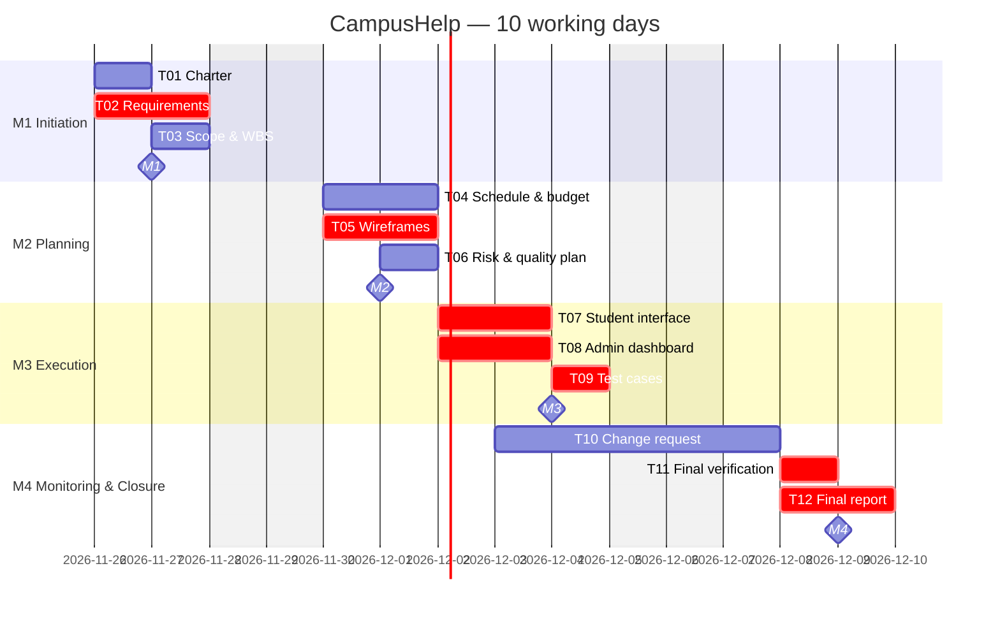

# Schedule, Dependencies and Budget — CampusHelp

| | |
|---|---|
| **Document ID** | PM-02 (Issue T04) |
| **Version** | 1.0 |
| **Date** | 26 November 2026 |
| **Role** | Project Manager (Student A) |
| **Depends on** | T03 Scope and WBS |

## 1. Working calendar

Day 1 = Thursday 26 Nov 2026. Weekends are non-working.

| Day | 1 | 2 | 3 | 4 | 5 | 6 | 7 | 8 | 9 | 10 |
|---|---|---|---|---|---|---|---|---|---|---|
| Date | 26 Nov | 27 Nov | 30 Nov | 1 Dec | 2 Dec | 3 Dec | 4 Dec | 7 Dec | 8 Dec | 9 Dec |
| Event | Start | **M1**, CP1 | | **M2** | CP2 | Change request | **M3** | CP3 | | **M4** |

CP = progress checkpoint (`docs/monitoring/`).

## 2. Task list and dependencies

| ID | Task | Role | Effort | Predecessor | Type | Planned start | Planned finish | Milestone |
|---|---|---|---|---|---|---|---|---|
| T01 | Develop project charter | A | 4 h | — | — | 26 Nov | 26 Nov | M1 |
| T02 | Gather stakeholder requirements | B | 4 h | — | — | 26 Nov | 27 Nov | M1 |
| T03 | Prepare scope and WBS | C | 4 h | T01 | Finish-to-Start | 27 Nov | 27 Nov | M1 |
| T04 | Prepare schedule, dependencies and budget | A | 4 h | T03 | Finish-to-Start | 30 Nov | 1 Dec | M2 |
| T05 | Design initial wireframes | B | 4 h | T02 | Finish-to-Start | 30 Nov | 1 Dec | M2 |
| T06 | Develop risk register and quality plan | C | 4 h | — | — | 1 Dec | 1 Dec | M2 |
| T07 | Create student request interface prototype | B | 4 h | T05 | Finish-to-Start | 2 Dec | 3 Dec | M3 |
| T08 | Create administrator dashboard prototype | A | 4 h | T05 | Finish-to-Start | 2 Dec | 3 Dec | M3 |
| T09 | Prepare and execute prototype test cases | C | 4 h | T07, T08 | Finish-to-Start | 4 Dec | 4 Dec | M3 |
| T10 | Evaluate and document change request | A | 3 h | Change request received (Day 6) | — | 3 Dec | 7 Dec | M4 |
| T11 | Perform final verification and issue review | C | 3 h | T09, T10 | Finish-to-Start | 8 Dec | 8 Dec | M4 |
| T12 | Consolidate final report and closure documents | B | 3 h | T11 | Finish-to-Start | 8 Dec | 9 Dec | M4 |
| | **Total** | | **45 h** | | | | | |

## 3. Dependency diagram

Red = critical path.

## 4. Gantt chart

## 5. Critical path and schedule risks

Critical path (longest chain of dependent work): **T02 → T05 → T07 / T08 → T09 → T11 → T12** = 4 + 4 + 4 + 4 + 3 + 3 = **22 h** of strictly sequential effort. The second chain T01 → T03 → T04 (12 h) has about 2 days of float.

Tasks that could delay the whole project:

| Task | Why it can delay the project |
|---|---|
| **T05 Wireframes** | Both prototype screens (T07, T08) start only after the wireframes are approved. A late or rejected wireframe delays all of M3. |
| **T07 / T08 Prototype screens** | Testing (T09) needs both screens. They are the largest technical risk (defects, browser problems) and have no float. |
| **T09 Testing** | Failed tests create rework on T07/T08 right before M3; final verification (T11) cannot start until testing is complete. |
| **T10 Change request** | It arrives on Day 6 from outside the team. If the analysis takes longer or the change is approved with a large effort, T11 and the final report move. |
| **T11 Final verification** | Only one day remains before the deadline afterwards; any missing evidence found here must be fixed under time pressure. |

## 6. Resource estimates

| Role | Tasks | Hours |
|---|---|---|
| A – Project Manager | T01, T04, T08, T10 | 15 h |
| B – Business Analyst & Designer | T02, T05, T07, T12 | 15 h |
| C – Quality & Risk Coordinator | T03, T06, T09, T11 | 15 h |
| **Total** | 12 tasks | **45 h** |

The load is balanced: each role owns four tasks and 15 hours.

## 7. Budget

Rate (given for this exercise): **50,000 UZS per person-hour**.

| Item | Hours | Rate (UZS) | Cost (UZS) |
|---|---|---|---|
| Role A – Project Manager | 15 | 50,000 | 750,000 |
| Role B – Business Analyst & Designer | 15 | 50,000 | 750,000 |
| Role C – Quality & Risk Coordinator | 15 | 50,000 | 750,000 |
| **Baseline (planned work)** | **45** | | **2,250,000** |
| Contingency reserve (10 %) | 4.5 | 50,000 | 225,000 |
| **Total budget incl. reserve** | **49.5** | | **2,475,000** |

Tools and services: GitHub Free, a web browser and a text editor — 0 UZS.

### Cost per milestone

| Milestone | Tasks | Hours | Cost (UZS) |
|---|---|---|---|
| M1 | T01, T02, T03 | 12 | 600,000 |
| M2 | T04, T05, T06 | 12 | 600,000 |
| M3 | T07, T08, T09 | 12 | 600,000 |
| M4 | T10, T11, T12 | 9 | 450,000 |
| **Total** | | **45** | **2,250,000** |

Actual hours are recorded in the Project Board field **Actual Hours** and compared with this baseline in the checkpoint and closure reports.

## 8. Baseline revision 1 — schedule compression (26 Nov 2026)

**Reason.** The project had to be delivered on 26 Nov 2026. Continuing with the 10-working-day plan would have delivered it on 9 Dec 2026, two weeks too late.

**Decision (PM, 26 Nov 2026).** Keep the scope and the 45-hour effort estimate unchanged, but compress the schedule into a single working day using

- **fast-tracking** — tasks without a hard dependency run in parallel (T01 ∥ T02, T04 ∥ T05 ∥ T06, T07 ∥ T08), and
- **crashing** — all three roles are worked by one person in consecutive sessions on the same day.

**Revised milestone dates.**

| Milestone | Original baseline | Revised baseline |
|---|---|---|
| M1 – Project Initiation | 27 Nov 2026 (Day 2) | 26 Nov 2026 |
| M2 – Project Planning | 1 Dec 2026 (Day 4) | 26 Nov 2026 |
| M3 – Project Execution | 4 Dec 2026 (Day 7) | 26 Nov 2026 |
| M4 – Monitoring and Closure | 9 Dec 2026 (Day 10) | 26 Nov 2026 |

**Effect on monitoring.** The three progress checkpoints planned for Day 2, 5 and 8 are held at the equivalent points of the compressed day: after M1, after M2/M3 and before closure (`docs/monitoring/`).

**Effect on budget and risk.** Planned effort and cost are unchanged (45 h, 2,250,000 UZS). Compression raises R1 (capacity) and R6 (missing evidence); both are covered by the verification step T11. The Day-6 change request (CR-01) is processed within the same day.
