# Scope Statement and Work Breakdown Structure — CampusHelp

| | |
|---|---|
| **Document ID** | QA-01 (Issue T03) |
| **Version** | 1.0 |
| **Date** | 26 November 2026 |
| **Role** | Quality & Risk Coordinator (Student C) |
| **Depends on** | T01 Project charter |

## 1. Scope statement

**Product scope:** a documented and demonstrated design of the CampusHelp portal — requirements, wireframes, a clickable HTML prototype of the student request screen and the administrator dashboard, and verified test results.

**Project scope:** all project-management work needed to plan, execute, monitor and close the project in GitHub (charter, WBS, schedule, budget, risk register, quality plan, change control, checkpoint and closure reports).

**Exclusions:** production code, real authentication, hosting, live e-mail / SMS, integration with university systems.

## 2. WBS diagram

```mermaid
flowchart TD
    P["1.0 CampusHelp Project"]
    P --> A["1.1 Initiation"]
    P --> B["1.2 Planning"]
    P --> C["1.3 Execution"]
    P --> D["1.4 Monitoring & Control"]
    P --> E["1.5 Closure"]

    A --> A1["1.1.1 Project charter (T01)"]
    A --> A2["1.1.2 Stakeholder requirements (T02)"]
    A --> A3["1.1.3 Scope statement & WBS (T03)"]

    B --> B1["1.2.1 Schedule, dependencies & budget (T04)"]
    B --> B2["1.2.2 Initial wireframes (T05)"]
    B --> B3["1.2.3 Risk register & quality plan (T06)"]

    C --> C1["1.3.1 Student request interface (T07)"]
    C --> C2["1.3.2 Administrator dashboard (T08)"]
    C --> C3["1.3.3 Test cases & execution (T09)"]

    D --> D1["1.4.1 Progress checkpoints (Day 2, 5, 8)"]
    D --> D2["1.4.2 Change request evaluation (T10)"]
    D --> D3["1.4.3 Final verification & issue review (T11)"]

    E --> E1["1.5.1 Final report & closure documents (T12)"]
```

## 3. WBS dictionary

| WBS | Work package | Deliverable | Issue | Owner role | Effort | Acceptance |
|---|---|---|---|---|---|---|
| 1.1.1 | Project charter | `docs/project-charter.md` | T01 | A – PM | 4 h | All charter components + ≥ 3 measurable success criteria |
| 1.1.2 | Stakeholder requirements | `docs/requirements.md` | T02 | B – BA | 4 h | Stakeholder analysis; FR/NFR cover all 6 features |
| 1.1.3 | Scope & WBS | `docs/wbs.md` | T03 | C – QA | 4 h | Diagram + dictionary; every Issue maps to a work package |
| 1.2.1 | Schedule, dependencies & budget | `docs/schedule-and-budget.md` | T04 | A – PM | 4 h | Dependency table/diagram, Gantt, budget, ≥ 3 critical tasks |
| 1.2.2 | Initial wireframes | `docs/wireframes.md` | T05 | B – BA | 4 h | Wireframes for submission, tracking and dashboard screens |
| 1.2.3 | Risk register & quality plan | `docs/risk-register.md`, `docs/quality-plan.md` | T06 | C – QA | 4 h | ≥ 5 risks with probability, impact, owner, mitigation |
| 1.3.1 | Student request interface | `prototype/index.html`, `prototype/track.html` | T07 | B – BA | 4 h | Required fields, validation, confirmation state |
| 1.3.2 | Administrator dashboard | `prototype/admin.html` | T08 | A – PM | 4 h | Counts, list, filters, assignment and status change |
| 1.3.3 | Test cases & execution | `docs/test-cases.md` | T09 | C – QA | 4 h | ≥ 6 test cases executed with Pass/Fail |
| 1.4.1 | Progress checkpoints | `docs/monitoring/` | — (PM overhead) | A – PM | — | Day 2, 5, 8 status reports |
| 1.4.2 | Change request | `docs/change-request.md` | T10 | A – PM | 3 h | Impact analysis and decision |
| 1.4.3 | Final verification | `docs/verification-report.md` | T11 | C – QA | 3 h | All Issues reviewed, evidence checked |
| 1.5.1 | Final report & closure | `docs/closure-report.md`, final PDF | T12 | B – BA | 3 h | Planned vs. actual, lessons learned |
| | **Total** | | | | **45 h** | |
