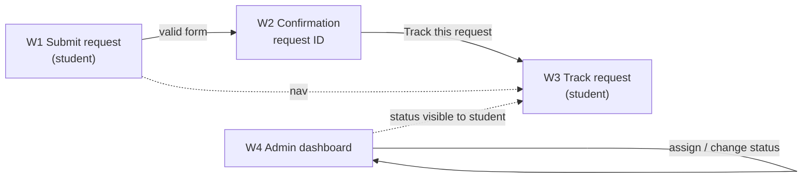

# Initial Wireframes — CampusHelp

| | |
|---|---|
| **Document ID** | BA-02 (Issue T05) |
| **Version** | 1.0 |
| **Date** | 26 November 2026 |
| **Role** | Business Analyst & Designer (Student B) |
| **Depends on** | T02 Requirements |

Low-fidelity layouts for the three core screens. They define *what* is on each screen and *where*; colours and final styling are decided in the prototype (T07, T08).

## Screen flow



## W1 — Submit a request (student)

```
+--------------------------------------------------------------+
| CampusHelp            [Submit request] [Track] [Admin]       |
+--------------------------------------------------------------+
| Submit a service request                                     |
|                                                              |
| Student ID *        [______________]                         |
| Full name           [______________________________]         |
| E-mail              [______________________________]         |
| Category *          [ Select a category          v]          |
|                       IT Support / Classroom Maintenance /   |
|                       Library Assistance / Administrative    |
| Priority *          ( ) Low   ( ) Medium   ( ) High          |
| Location            [______________]  e.g. Room B-204        |
| Description *       [                                  ]     |
|                     [                                  ]     |
|                                                              |
| * required          ! Error text appears under each field    |
|                                                              |
|                                  [ Submit request ]          |
+--------------------------------------------------------------+
```

Requirements: FR-01, FR-02, FR-03, FR-04, NFR-03.

## W2 — Confirmation (student)

```
+--------------------------------------------------------------+
|  ✔ Your request has been submitted                           |
|                                                              |
|  Request ID:   CH-2026-0007                                  |
|  Category:     IT Support         Priority: High             |
|  Status:       Submitted                                     |
|                                                              |
|  Keep this ID to check the status of your request.           |
|                                                              |
|  [ Track this request ]     [ Submit another request ]       |
+--------------------------------------------------------------+
```

Requirements: FR-05.

## W3 — Track a request (student)

```
+--------------------------------------------------------------+
| Track your request                                           |
| Request ID [ CH-2026-0007 ]  [ Search ]                      |
|--------------------------------------------------------------|
| CH-2026-0007 · IT Support · High            [ In Progress ]  |
| "Projector in B-204 does not turn on"                        |
| Assigned to: IT Support – Aziz K.                            |
|                                                              |
| History                                                      |
|  ● 26 Nov 10:02  Submitted                                   |
|  ● 26 Nov 10:30  Assigned to IT Support – Aziz K.            |
|  ● 26 Nov 11:15  In Progress                                 |
+--------------------------------------------------------------+
```

Requirements: FR-06, FR-11.

## W4 — Administrator dashboard

```
+--------------------------------------------------------------+
| CampusHelp · Administrator                                   |
+--------------------------------------------------------------+
| +-----------+  +-----------+  +-----------+  +-----------+   |
| | Open   4  |  | Ongoing 3 |  | Done    5 |  | Total  12 |   |
| +-----------+  +-----------+  +-----------+  +-----------+   |
|                                                              |
| Filter: [Status v] [Category v] [Priority v]  [Search ID ]   |
|--------------------------------------------------------------|
| ID           Category     Priority  Status       Assigned to |
| CH-2026-0007 IT Support   High      In Progress  [Aziz K. v] |
| CH-2026-0006 Library      Low       Submitted    [-- v]      |
|  ...                                    [Status v] [Save]    |
+--------------------------------------------------------------+
```

Open = Submitted · Ongoing = Assigned + In Progress · Done = Resolved + Closed.
Requirements: FR-07, FR-08, FR-09, FR-10.

## Mobile layout (360 px)

The form becomes one column; the dashboard tiles wrap to two per row and the table turns into a list of cards (ID, status badge, category, priority, assignment controls).

## Review

| Reviewer role | Result | Comment |
|---|---|---|
| A – PM | Approved | All six features from the charter are visible in W1–W4. |
| C – QA | Approved | Each wireframe lists its requirements, so test cases can be traced. |
